# Atmosphere Splitter

A single web page that splits a chunk of text into a thread and posts it in one go. It can be
installed as an app, and it signs in with atproto OAuth (or an app password, if you prefer).

## Features

### Installable app with atproto sign-in

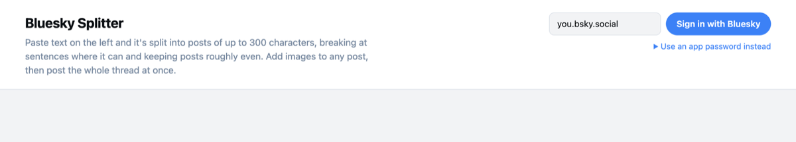

Install it from `http://127.0.0.1:8000/` (or a hosted deployment) and sign in with atproto OAuth; app
passwords remain the fallback for a file opened from disk.

### Smart splitting

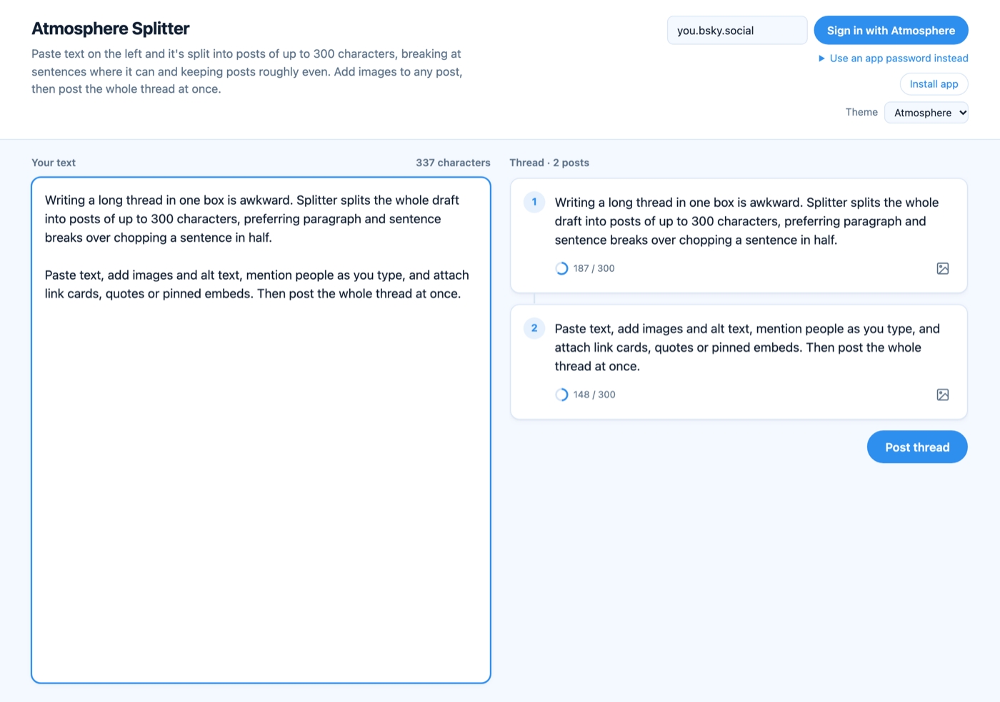

Posts break at sentence boundaries where possible, with lengths kept roughly even. Word breaks are a
fallback, used only when sentence breaks would leave a post very short or over the 300-character
limit. Paragraph breaks are preferred but not forced.

### Images with alt text

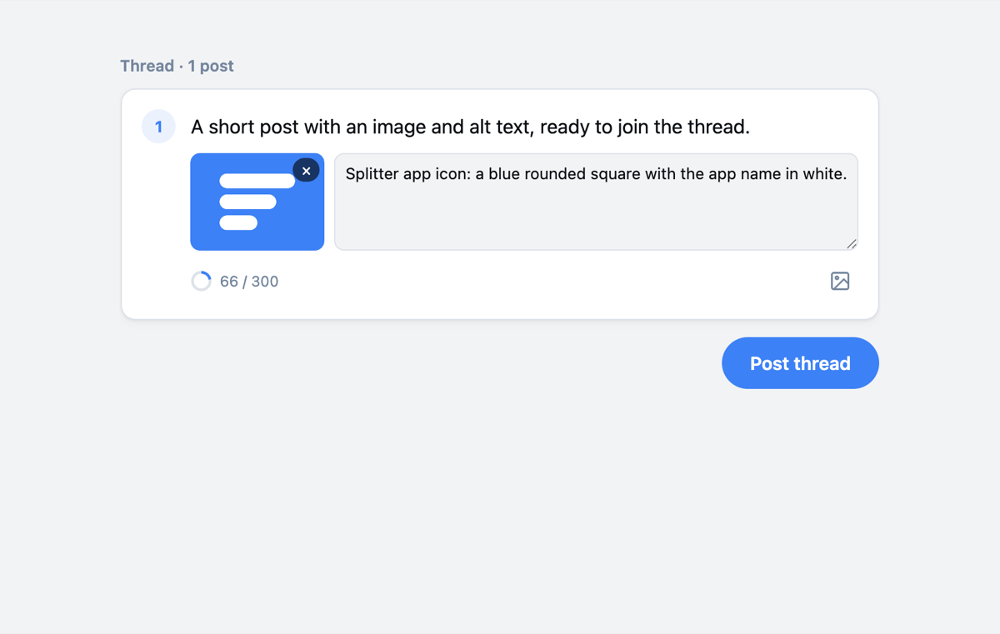

Add up to four images to any post, each with its own alt text. Large images are resized to fit
Bluesky's 1 MB limit.

### Links, hashtags and mentions

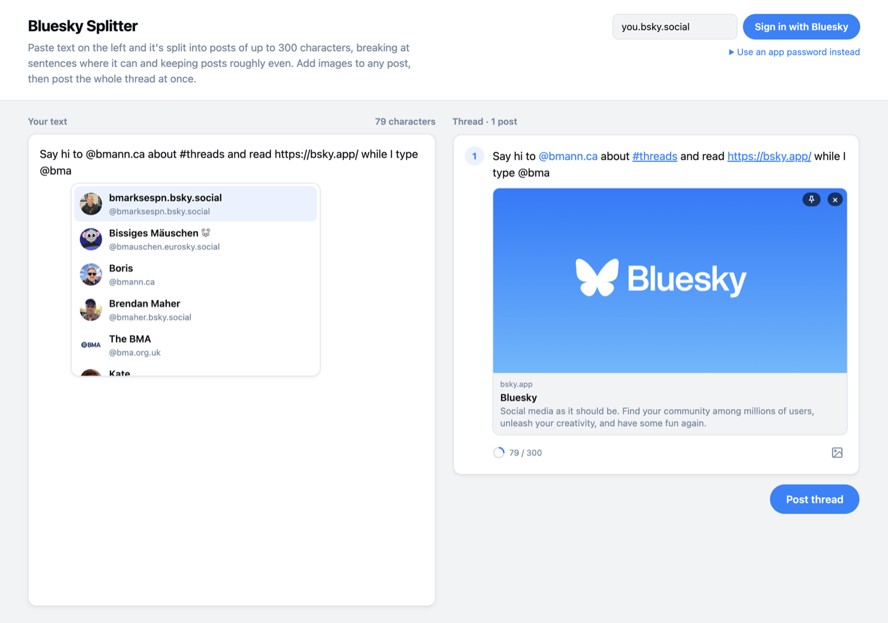

All three become facets that Bluesky renders as links. Typing `@` searches accounts as you type and
stores the pick with its DID; hand-typed handles resolve the same way. A handle that doesn't resolve
stays plain text instead of failing the post.

### Tags on every post

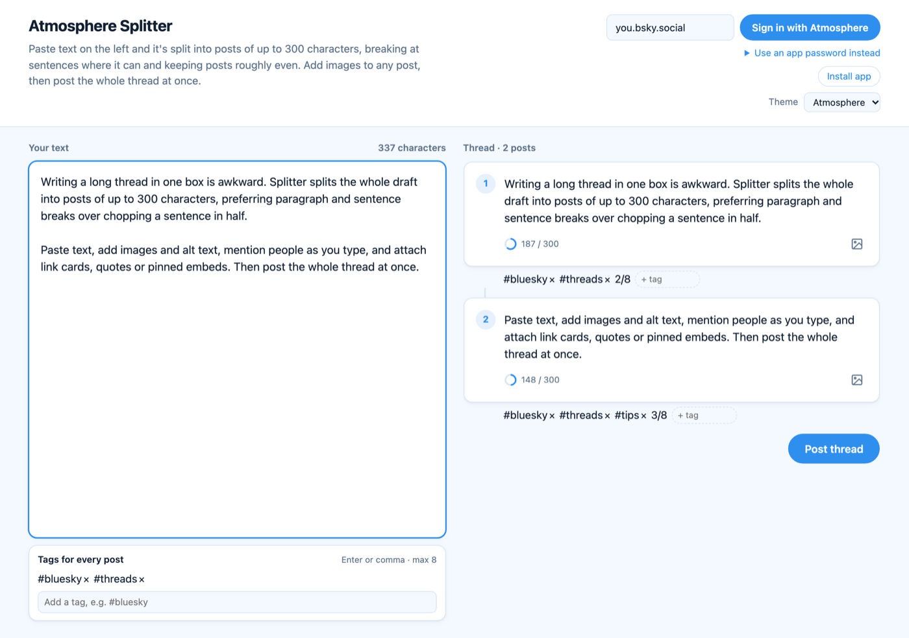

Add tags in the left panel once and they are attached to every post as out-of-band
`app.bsky.feed.post.tags` — the body text is untouched. In the preview, the pills under each post
show its tags: use **+ tag** to add one to a single post, or **×** to remove a thread-wide tag from
just that post. Up to 8 tags per post; tags already typed in the body are not duplicated, and going
over 8 is flagged and blocks posting.

### Link previews

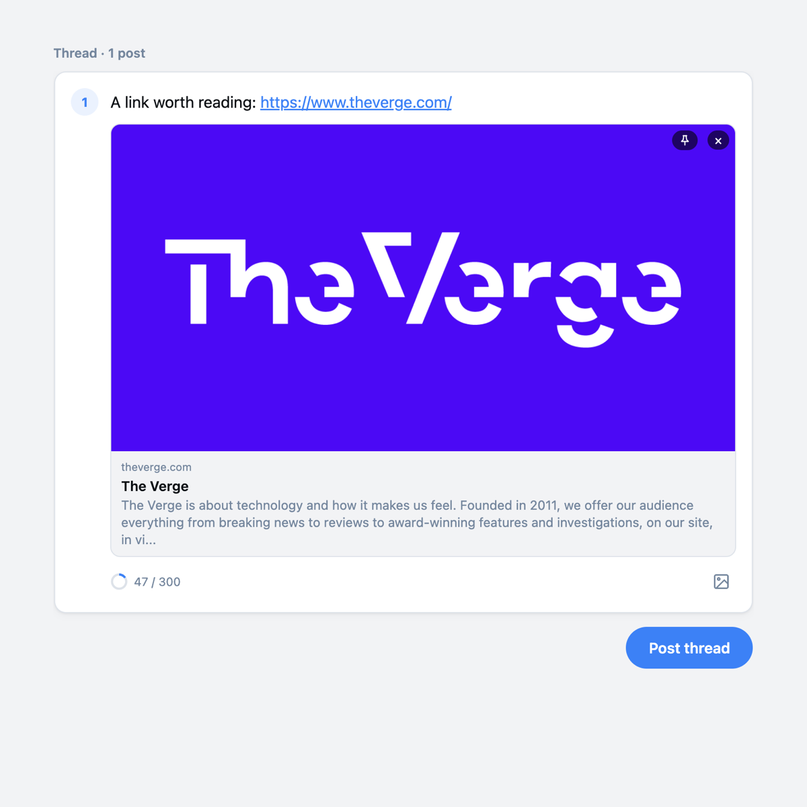

The first link in a post without images shows a card as you type — the same card that gets posted,
fetched once through `cardyb`. Use × to drop it, so a bad preview never gets embedded. A card with no
image says `cardyb returned no image`; a URL with no preview says so instead of leaving a blank.

### Quote posts

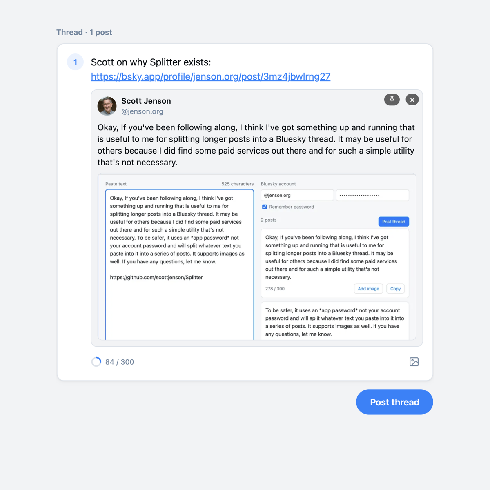

A Bluesky post URL becomes a real quote (a record embed), previewed with the author, text and first
image while you type. A post that cannot be fetched falls back to plain text instead of blocking the
thread.

### Pinned embeds

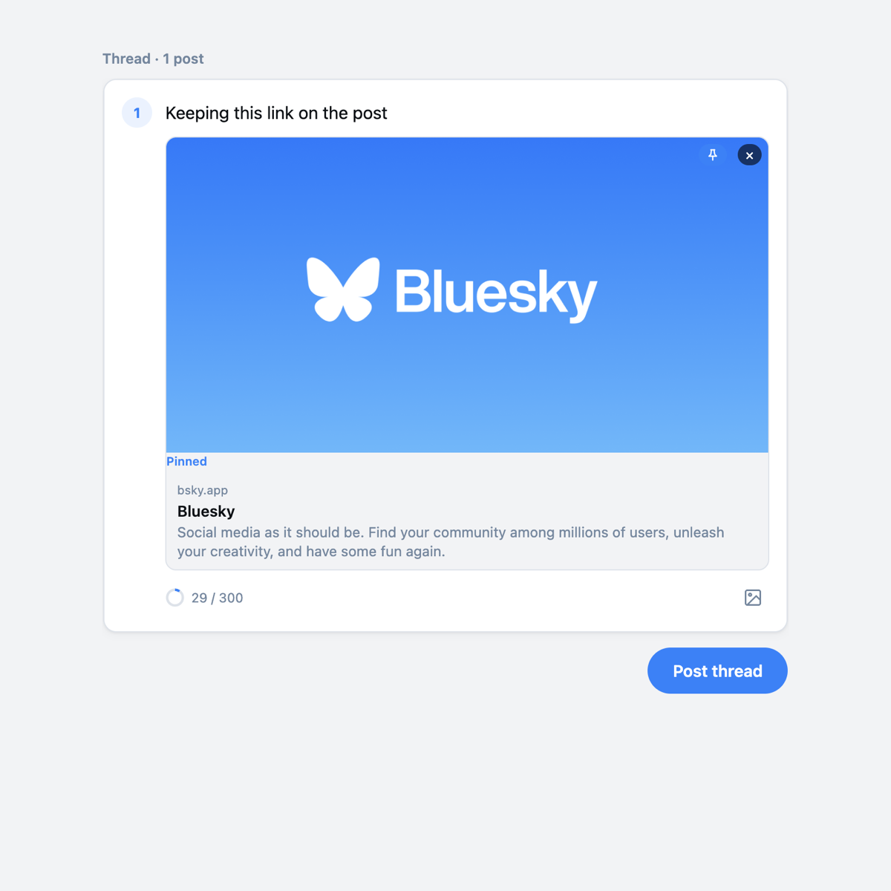

Pin a card or quote to keep it attached after deleting the URL from the post text. Unpin returns it
to following the URL, and a pinned preview whose lookup failed can be retried or unpinned.

### Resume a failed thread

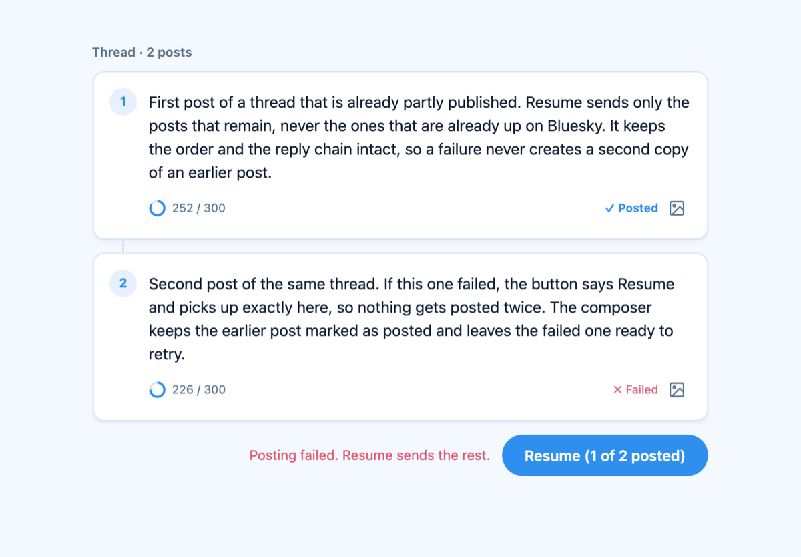

If posting fails partway, the button resumes from where it stopped instead of starting over. Posts
already on Bluesky stay marked as posted, so nothing is sent twice.

### New thread or continue

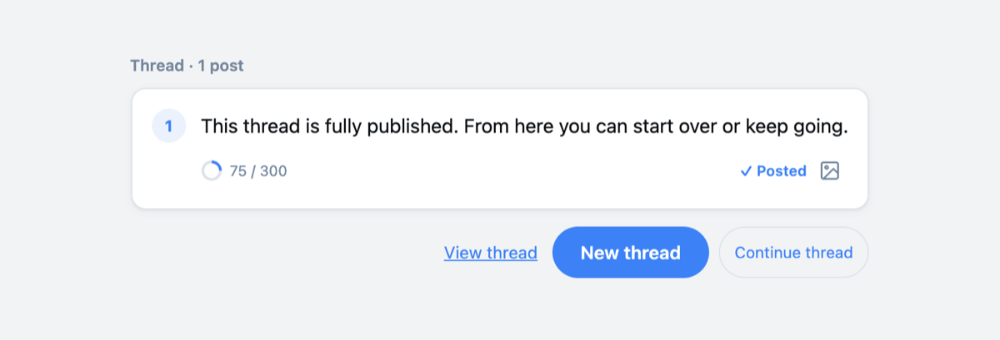

After a thread publishes, start clean or reply to its last post and grow the same thread.

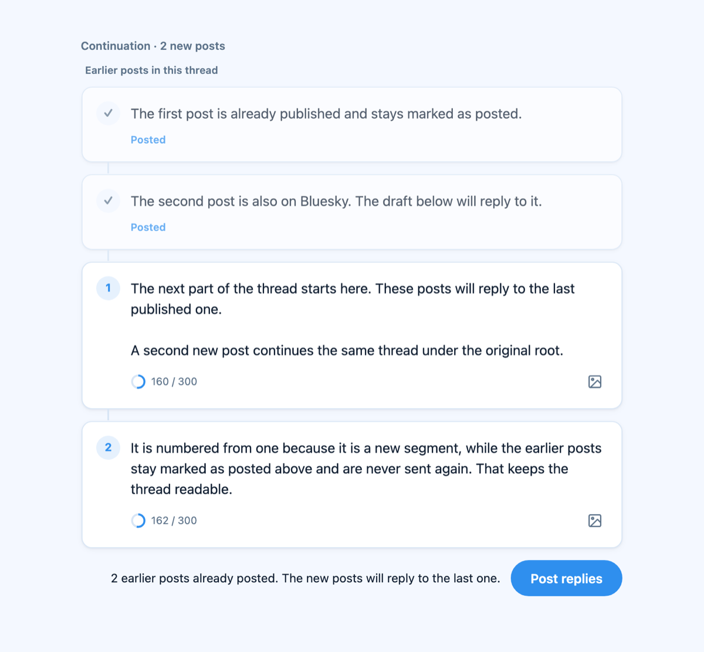

Earlier posts stay visible, marked as posted, while the new ones are drafted. A failed thread only
offers Resume.

## Themes

Atmosphere is the default: a light blue palette that doesn't make Bluesky the product's identity.
Pick another in the header; the choice is remembered and follows the system light/dark setting.

| Theme | Palette |
| --- | --- |
| Atmosphere | light blue, the neutral default |
| Bluesky | Bluesky blue |
| Blacksky | Blacksky black and indigo |
| Mu.Social | Mu.Social pink |

The four built-ins live in `index.html` so they work from `file://`. Community themes live in
`themes/`: add a folder and a line in `themes/index.json`, reload, and it appears in the picker. See
[`themes/README.md`](themes/README.md) for the format, the JSON schema and a complete example.

The sign-in button follows the theme: **Sign in with Atmosphere** by default, then **Sign in with
Bluesky**, **Sign in with Blacksky**, or **Sign in with Mu**. Community themes can set their own
`signIn` label.

Community themes need the local server because browsers cannot fetch their JSON from `file://`.
The theme choice is stored locally, and the last community token block is cached so it applies before
paint on the next visit.

## Use

There are a few ways to open it, and they differ in what sign-in they allow.

### Hosted on GitHub Pages

Open <https://splitter.bmannconsulting.com/>. It installs as a PWA, works offline after the first load,
and signs in with OAuth from that origin. The deployment is the static app on the `gh-pages` branch,
with its own `client-metadata.json`.

### From a local server (OAuth works here)

```sh
python3 -m http.server 8000 --bind 127.0.0.1
```

Then open <http://127.0.0.1:8000/>.

Use `127.0.0.1`, not `localhost`: Bluesky's authorization server rejects `localhost` as a sign-in
address (RFC 8252 asks for a loopback IP). The app notices and links you to the right address.

This is also the address to install from: use the install button in the header, or your browser's
install icon in the address bar. Once installed it opens in its own window and works offline.

### As a file on disk

Open `index.html` directly. Everything except Bluesky sign-in works that way; if you want to post,
use an app password.

## Signing in

The sign-in button — **Sign in with Atmosphere** by default, or the active theme's label — uses
atproto OAuth. The browser goes to the account's authorization service, you approve, and you come
back signed in. It asks for one narrow permission — create posts, including uploading images — so it
cannot read your timeline, change your profile, or delete posts.

A few things are worth knowing:

- The consent screen shows `http://localhost?…` on loopback and the `client-metadata.json` URL on
  the hosted site, rather than a familiar app name. Bluesky doesn't render metadata for clients it
  hasn't seen before. The URL is the permission request itself.
- Sessions last about two weeks. When one expires, Splitter asks you to sign in again.
- The session belongs to the address you signed in at. Changing the port means signing in again.
- On an iPhone or iPad, sign in from a Safari tab before adding the app to the home screen. A
  home-screen app has its own storage and cannot finish the redirect.

**App passwords** still work, and are the only option for a file opened straight from disk. Create
one under Settings → Privacy and security → App passwords, and make one just for Splitter so you can
revoke it without touching anything else. Splitter refuses your account password.

## Privacy

Everything runs in your browser. Your text, images and credentials go only to Bluesky. Link previews
are fetched through `cardyb.bsky.app`, the same service Bluesky's own app uses. Handle search goes to
`typeahead.waow.tech`, a community actor search for atproto, which sees the letters you type after
`@`; resolving a handle asks `public.api.bsky.app`, and a quoted-post permalink is also resolved
there, sending only that URL. `did:plc` documents come from `plc.directory`. None of them see your
posts. The handle is remembered locally. An app password is saved in local storage only if you tick
"Remember" — any other page on the same address can read it, so leave that off on shared machines.
OAuth tokens and the signing key live in IndexedDB, never in local storage.

## How the OAuth bit works

There is no client library; the app speaks the protocol directly.

- The client identifier is the loopback form `http://localhost?redirect_uri=…&scope=…` on
  `127.0.0.1`, and `<origin>/client-metadata.json` on HTTPS. The GitHub Pages deploy ships that
  document; any other host needs its own.
- Login uses pushed authorization requests and PKCE.
- Tokens are bound to a non-extractable ECDSA P-256 key (DPoP) that never leaves the browser.
- The scopes requested are `atproto` plus `include:app.bsky.authCreatePosts` and a blob scope for
  image uploads — no `transition:generic`.

## Deployment

The hosted version is served by GitHub Pages from the `gh-pages` branch at
<https://splitter.bmannconsulting.com/>. That branch is the static app plus `client-metadata.json`,
`.nojekyll` and a `CNAME` file; there is no build step or server. `splitter.bmannconsulting.com` is a
DNS-only CNAME to `bmann.github.io`. To deploy an app change, copy the files from `main` to the branch
and push. The metadata document is host-specific: a fork at another origin needs its own `client_id`
and `redirect_uris`. GitHub Pages must have a TLS certificate for the custom domain before mobile
install or OAuth works over HTTPS.

## Layout

| File | Purpose |
| --- | --- |
| `index.html` | the whole app: markup, styles, script |
| `manifest.webmanifest` | name, icons, install behaviour |
| `sw.js` | service worker caching the app shell |
| `icons/` | SVG sources and generated PNGs |
| `themes/` | theme format, schema, example and community themes |
| `client-metadata.json` | hosted OAuth client document, on the `gh-pages` branch |
| `docs/screenshots/` | images used in this README |

## Development

No build step, no dependencies, no bundler. Edit `index.html` and reload. Two things to remember:

- Icons are generated from the SVGs: `rsvg-convert -w 512 -h 512 icons/icon.svg -o icons/icon-512.png`
  (and likewise for 192; `icon-maskable.svg` is the source for the maskable and Apple touch icons).
- When `index.html`, the icon set, or a built-in palette changes, bump `VERSION` in `sw.js`, or
  installed copies will keep the old shell until the cache expires.
